<div align="center">

# Astro Kitty 🐱
### Junior Astronaut Mission Trainer

**Fly to Mars. Train like an astronaut. Keep a Mars base alive.**<br>
A playful web game for kids aged 7–12, powered by real NASA space-weather data.

<a href="https://astro-kitty-mission-trainer.vercel.app"></a>


<br><br>

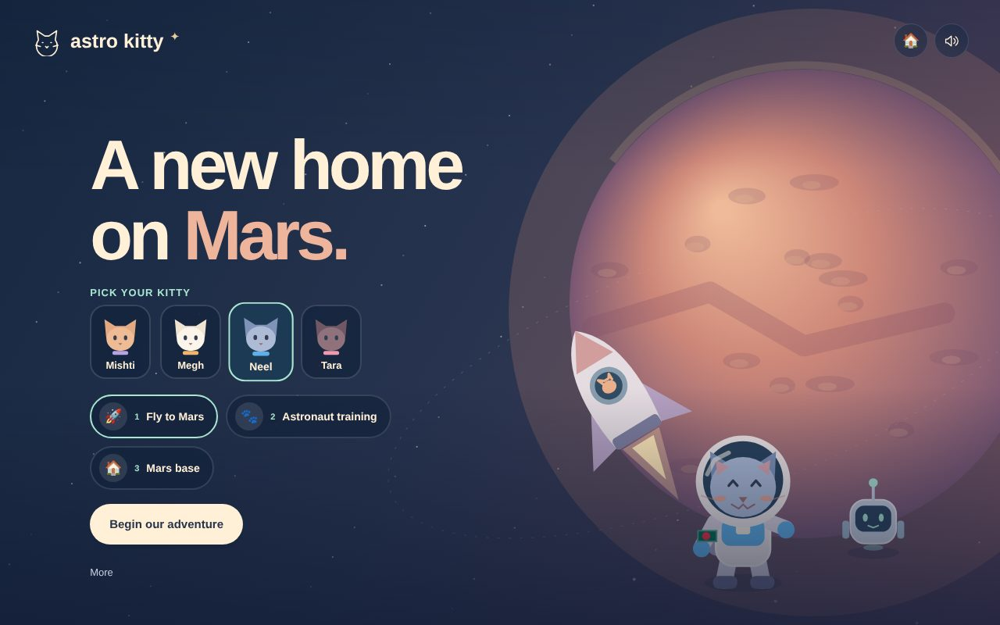

</div>

---

## 🌟 What is Astro Kitty?

Astro Kitty is our answer to the NASA Space Apps Challenge **“Build a Junior Astronaut Mission Trainer.”**

Kids pick a kitty astronaut and, with **Dhrubo** (ধ্রুব, “pole star”), a friendly robot buddy, take on a real Mars mission in **three steps**:

<table>
<tr>
<td align="center" width="33%"><b>1 · Fly to Mars </b><br><sub>Plan the trip, then watch it play out</sub></td>
<td align="center" width="33%"><b>2 · Astronaut training 🐾</b><br><sub>Hands-on skills: power, shelter, rover</sub></td>
<td align="center" width="33%"><b>3 · Mars base </b><br><sub>Five Mars days, real choices, real data</sub></td>
</tr>
</table>

Kids learn by **doing and watching**, not by reading. Every right move earns a cheer: **“Shabbash!”** (Good job!), **“Oshadharon!”** (Amazing!), a happy meow and a little bounce.

---

## 🚀 Step 1 · Mission Simulator: Earth to Mars

Kids plan the trip in four picture choices: **launch day**, **push**, **path** and **landing gear**. Then they press **Launch!** and watch their own plan fly.

<table>
<tr>
<td width="50%">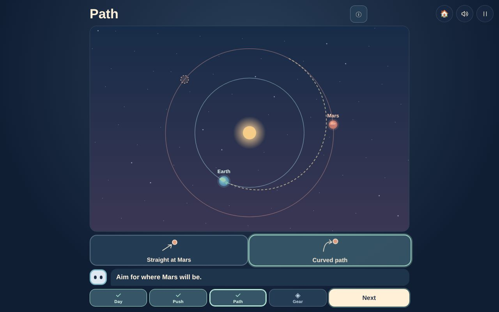</td>
<td width="50%">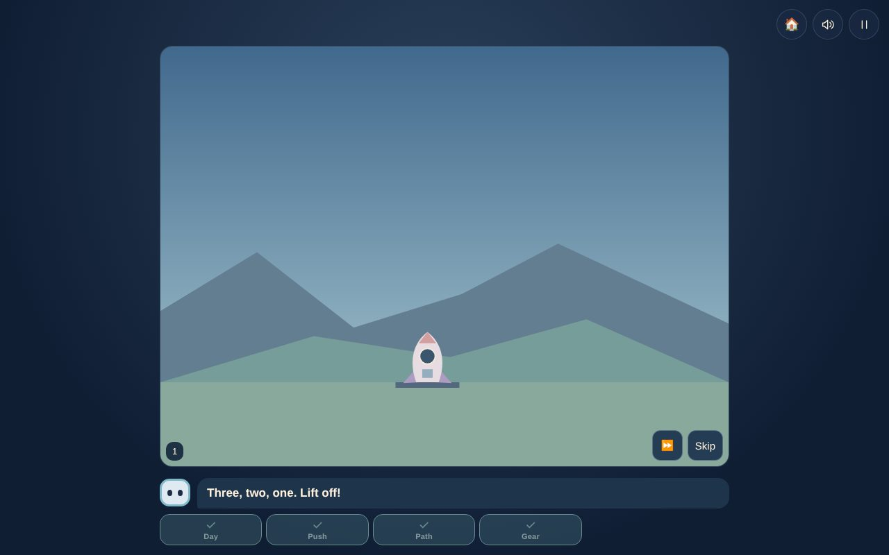</td>
</tr>
<tr>
<td><b>Aim for where Mars <i>will</i> be.</b> A straight path misses, because Mars keeps moving.</td>
<td><b>Liftoff!</b> Too little push and the rocket falls back. Too much and it zooms past Mars.</td>
</tr>
</table>

<p align="center">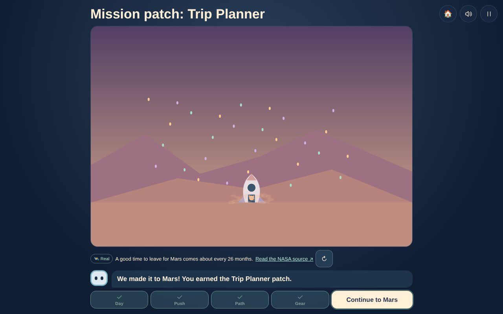<br><sub>Heat shield + parachute + landing rockets = a soft landing and the <b>Trip Planner</b> patch.</sub></p>

Every mistake plays its **own animation**, so kids *see* why it failed and try again. No paragraphs to read.

---

## 🐾 Step 2 · Astronaut Training

A walk-and-tap story inside the base, with puzzles kids solve with their hands.

<table>
<tr>
<td width="50%">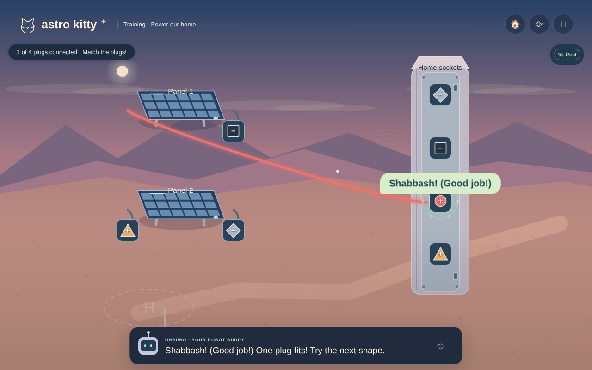</td>
<td width="50%">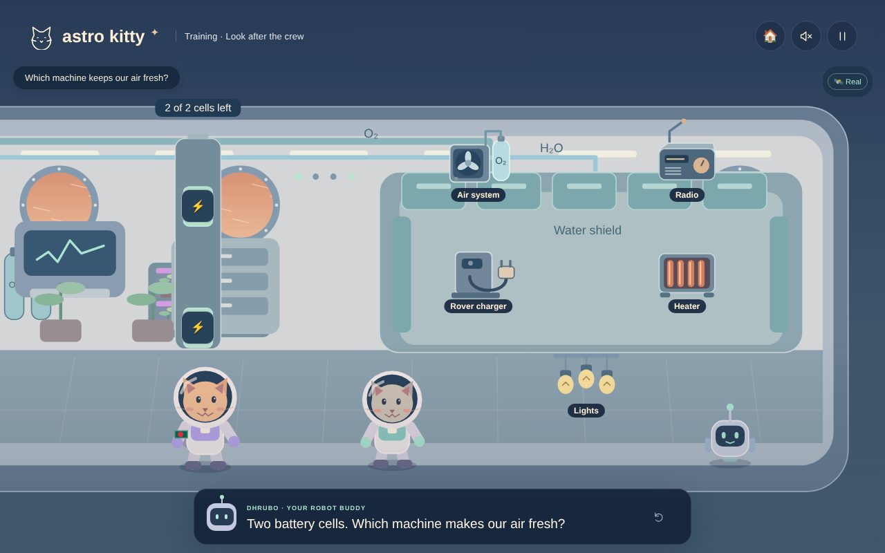</td>
</tr>
<tr>
<td><b>Power our home.</b> Match each solar-panel plug to its socket by shape <i>and</i> colour (colour-blind friendly). Wrong plugs shake and say “try again.”</td>
<td><b>Look after the crew.</b> Only two battery cells! Which machine makes our air fresh? Which one talks to Mission Control?</td>
</tr>
<tr>
<td width="50%">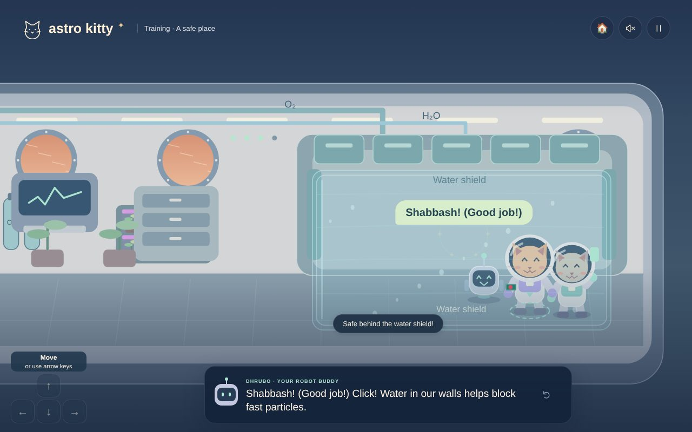</td>
<td width="50%">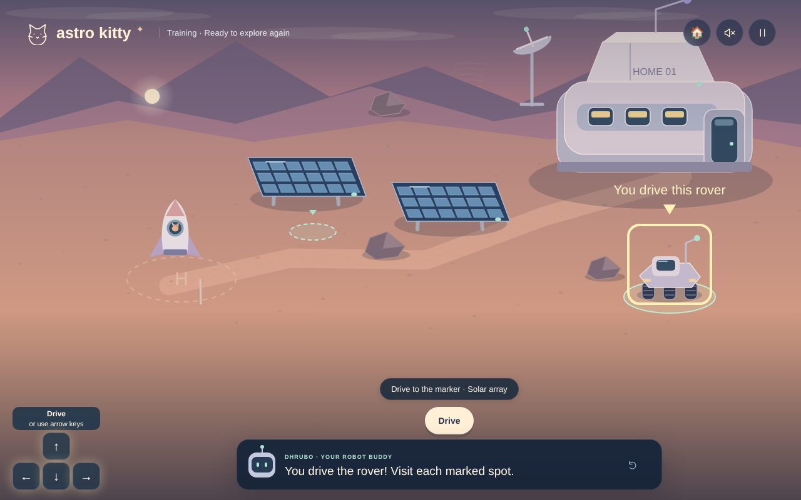</td>
</tr>
<tr>
<td><b>Hide from the storm.</b> Through the airlock, into the shelter, and the water gate slides shut. Water helps block fast particles.</td>
<td><b>Explore again.</b> Drive the rover and scan three marked spots.</td>
</tr>
</table>

### ☀️ The solar storm

<p align="center">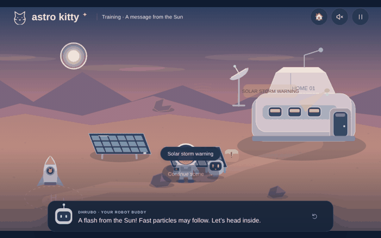<br>
<sub>First the flash of light… then the fast particles. Those are what real crews hide from.</sub></p>

---

## 🏠 Step 3 · Run the Mars Base

Choose a **real landing site**, design the base, then keep the crew safe for **five Mars days (sols)**. Kids share a few **Sunshine cells** between air, water, food and the water wall. Every day brings a surprise: a leak, a dust devil, a chilly night, ice to dig up, or a **real solar storm from NASA’s records**.

<table>
<tr>
<td width="50%">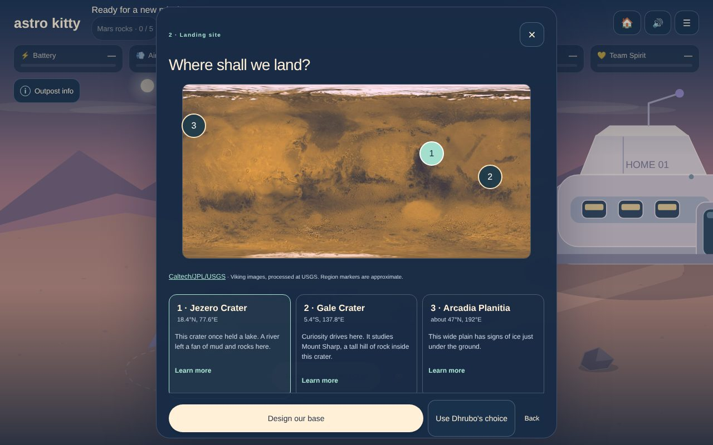</td>
<td width="50%">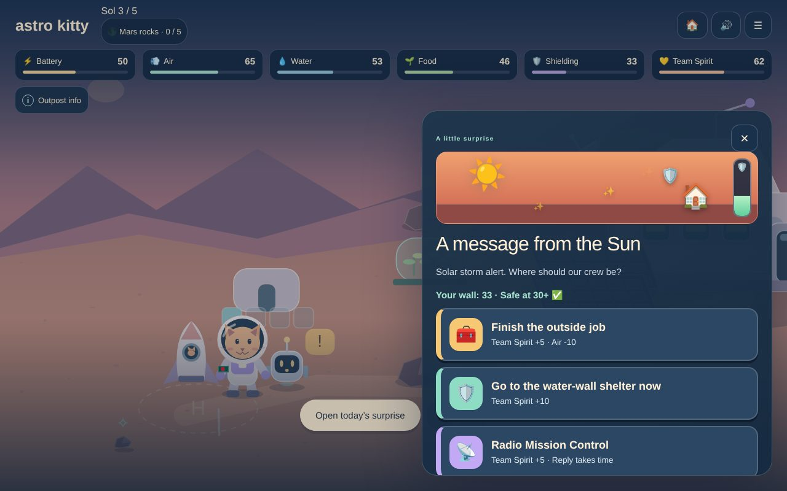</td>
</tr>
<tr>
<td><b>Pick a real place.</b> Jezero Crater, Gale Crater or Arcadia Planitia, on a real Viking map of Mars.</td>
<td><b>A message from the Sun.</b> Is the water wall strong enough? Shelter now, finish the job, or radio Earth?</td>
</tr>
<tr>
<td width="50%">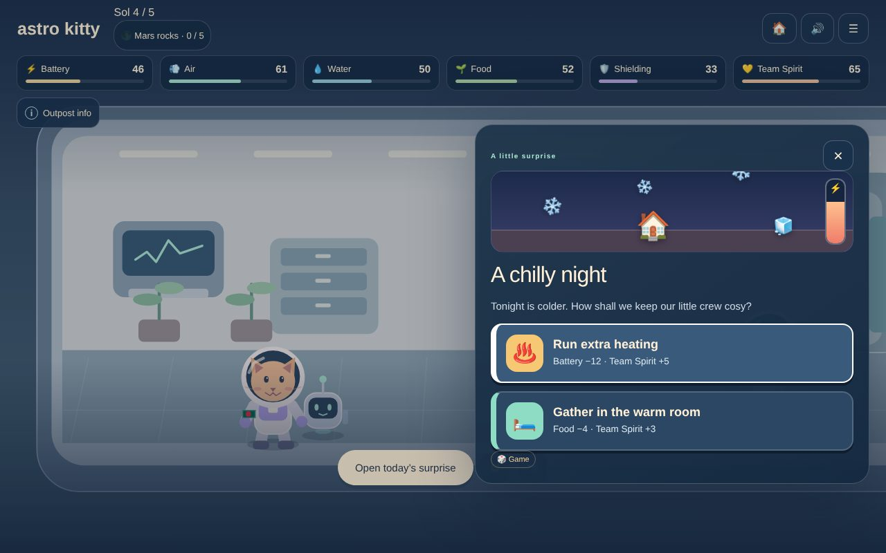</td>
<td width="50%">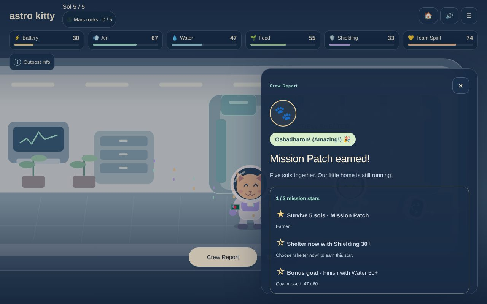</td>
</tr>
<tr>
<td><b>Every event is animated.</b> Snow falls, tanks drain or fill, so kids see what is happening.</td>
<td><b>Mission Patch!</b> Stars, praise and a “What you learned” box tied to the kid’s own choices.</td>
</tr>
</table>

---

## 🛰️ Real NASA data inside the game

| What | How Astro Kitty uses it |
| --- | --- |
| **[NASA Open APIs](https://api.nasa.gov/) + [DONKI space weather](https://ccmc.gsfc.nasa.gov/tools/DONKI/)** | Every solar storm is a **real flare record**. The game fetches the latest flares live and falls back to an archive of 9 verified flares when offline. The flare class (C, M or X) sets how strong the shelter must be. |
| **Viking map of Mars** (Caltech/JPL/USGS) | The real map used to pick a landing site. |
| **[USGS Gazetteer](https://planetarynames.wr.usgs.gov/Feature/348) and Mars 2020 site studies** | Real coordinates for Jezero, Gale and Arcadia. |
| **[Mars Trek](https://trek.nasa.gov/mars/)** | Each landing site links to explore it on real NASA Mars maps. |
| **NASA mission science** | Short “Real NASA fact” cards: Curiosity’s radiation readings, the May 2024 Mars solar storm, MOXIE making oxygen, the space station’s 98% water recycling, InSight’s dusty solar panels, Perseverance’s trip and more. |

Every fact carries a small **🛰️ Real** badge, and every made-up game rule carries a **🎲 Game** badge, so kids always know which is which. Sources sit in tap-to-open “Learn more” drop-downs, out of the way.

**Also explored from the official Space Apps resources:** [OSDR](https://osdr.nasa.gov/), [RadLab](https://visualization.osdr.nasa.gov/radlab/gui/data-api/), and the Canadian Space Agency’s [STEM resources](https://www.asc-csa.gc.ca/eng/youth-educators/resources-stem-and-youth-organizations.asp) and [food production toolkit](https://www.asc-csa.gc.ca/eng/youth-educators/toolkits/food-production/).

---

## 🧒 Designed for kids

<table>
<tr>
<td width="62%">

- **Less text, more action.** Big picture cards, short lines and animations that show what is happening.
- **A friendly guide.** Dhrubo speaks every line aloud, with captions.
- **Praise in Bangla and English.** Shabbash! Oshadharon! Purr-fect!
- **Four kitties to choose from:** Mishti, Megh, Neel and Tara.
- **Safe to fail.** Wrong answers cost nothing, and the crew is always safe.
- **Accessible.** Keyboard controls, screen-reader labels, captions, big-text and reduced-motion modes, colour-blind-friendly puzzles.
- **Works anywhere.** Phones, tablets and laptops, and offline after the first visit.
- **Teacher page** with ideas for using the game in class.

</td>
<td width="38%" align="center">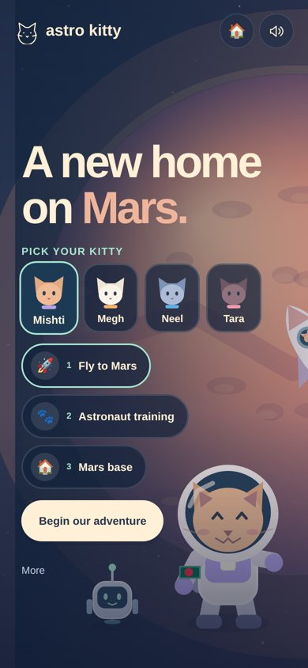</td>
</tr>
</table>

---

## 🎯 What kids learn

1. **Water does three jobs:** drinking, growing plants and shielding the crew from radiation.
2. **Space weather is real,** and walls (especially water walls) protect astronauts.
3. **Earth is far away.** Messages take 3–22 minutes, so the crew must plan ahead and decide for itself.
4. **Getting to Mars is about timing:** launch windows, enough push, aiming ahead, and landing gear for thin Martian air.

---

## 💻 Run it yourself

No build step and no libraries; plain HTML, CSS and JavaScript.

```bash
git clone https://github.com/RAFI-ULL-BARI/Astro-Kitty-NASA-Space-Apps.git
cd Astro-Kitty-NASA-Space-Apps/dist
python3 -m http.server 8000
# open http://localhost:8000
```

Run the tests (Node.js 18+): `npm test`

```
dist/        the game (deploy this folder)
test/        automated tests for the game rules and balance
docs/        screenshots and technical notes
```

Full technical notes: **[docs/TECHNICAL.md](docs/TECHNICAL.md)**

---

## 👩‍🚀 Team Astro Kitty 🇧🇩

**Rafiull Bari** and **Saad Uddin Ahmad Basit**, Bangladesh.<br>
Made with ❤ for the NASA Space Apps Challenge 2026.

---

<sub>NASA does not endorse any non-U.S. Government entity and is not responsible for information contained on non-U.S. Government websites. Astro Kitty is an independent student project and is not affiliated with or endorsed by NASA. The Mars map is © Caltech/JPL/USGS (Viking images, processed at USGS), used for education.</sub>
