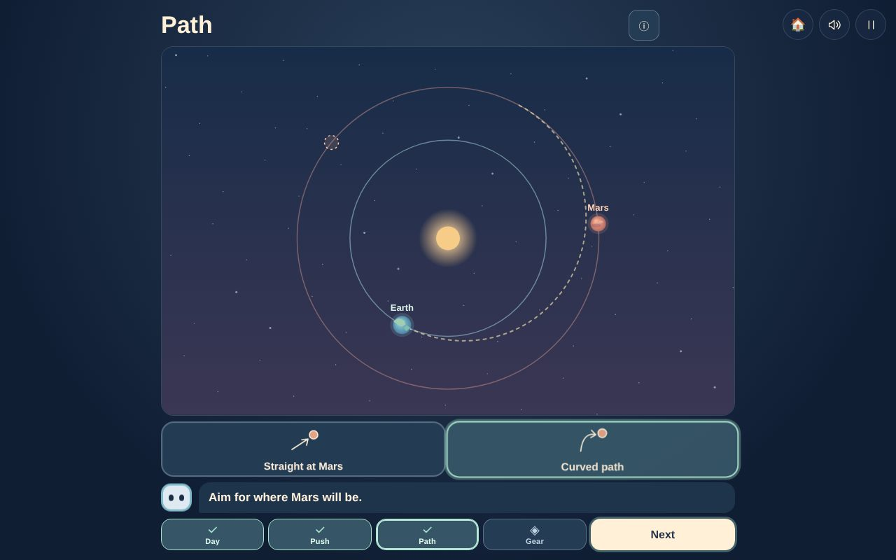
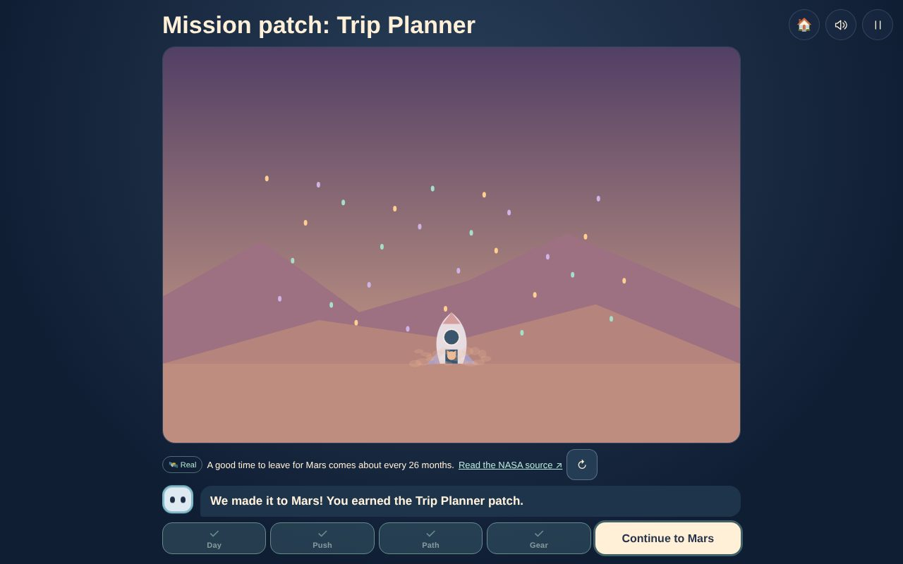
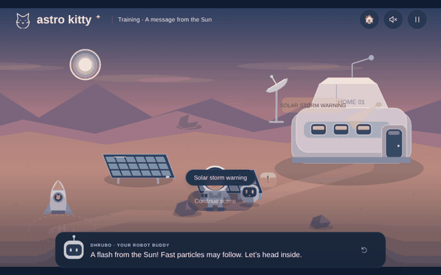
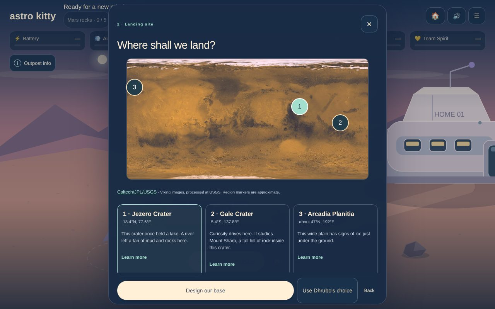

<div align="center">

# 🐱🚀 Astro Kitty
### Junior Astronaut Mission Trainer

**Train on Earth. Fly to Mars. Explore a 3D Mars world. Keep a Mars base alive.**<br>
A playful web game for kids aged 7–12, built on real NASA space data.

<a href="https://astro-kitty-mission-trainer.vercel.app"></a>

<a href="https://github.com/RAFI-ULL-BARI/Astro-Kitty-NASA-Space-Apps/actions/workflows/test.yml"></a>


<br><br>


</div>

---

## 🌟 What is Astro Kitty?

Astro Kitty is our answer to the NASA Space Apps Challenge **“Build a Junior Astronaut Mission Trainer.”**

Kids pick a kitty astronaut and, with **Dhrubo** (ধ্রুব, “pole star”), a friendly robot buddy, go from a space center in Khulna, Bangladesh, all the way to a home on Mars.

<table>
<tr>
<td align="center" width="25%"><b>1 · Earth Academy 🌍</b><br><sub>Five hands-on science labs</sub></td>
<td align="center" width="25%"><b>2 · Fly to Mars 🚀</b><br><sub>Plan the trip, then watch it fly</sub></td>
<td align="center" width="25%"><b>3 · Astronaut training 🐾</b><br><sub>Power, shelter, rover</sub></td>
<td align="center" width="25%"><b>4 · Mars base 🏠</b><br><sub>Five Mars days, real choices</sub></td>
</tr>
</table>

Then the whole planet opens up in **3D**.

Kids learn by **doing and watching**, not by reading. Every right move earns a cheer: **“Shabbash!”** (Good job!), **“Oshadharon!”** (Amazing!), a happy jump and confetti.

---

## 🪐 Kitty’s Mars Adventure 3D

A walkable 3D Mars world with **24 missions in six chapters**. Kids brush dusty solar panels, drill a rock core, drive a six-wheel rover through crater gates, race a dust storm home, make oxygen, water a space garden and call Earth.

<table>
<tr>
<td width="50%"></td>
<td width="50%"></td>
</tr>
<tr>
<td><b>Hands-on tools.</b> Hold to brush, scan, drill and repair. A simple arrow always points to the next job.</td>
<td><b>Drive the rover.</b> Follow the glowing gates across craters and dunes.</td>
</tr>
<tr>
<td width="50%"></td>
<td width="50%"></td>
</tr>
<tr>
<td><b>A home on Mars.</b> Fit the air filter, start the oxygen machine, balance the water and grow lunch.</td>
<td><b>Explore Mars in 3D.</b> Spin a real map of Mars, replay real storms and read Curiosity’s weather.</td>
</tr>
</table>

It runs smoothly on phones too: the game lowers its own picture detail when a device is slow, so play stays quick.

---

## 🌍 Step 1 · Earth Academy

Five labs at the fictional **National Kitty Space Center** in Khulna: floating, rover testing, growing food, gravity and making air.

<p align="center"></p>

## 🚀 Step 2 · Fly to Mars

Kids plan the trip in four picture choices: **launch day**, **push**, **path** and **landing gear**. Then they watch their own plan fly. Every mistake plays its own animation, so kids *see* why it failed.

<table>
<tr>
<td width="50%"></td>
<td width="50%"></td>
</tr>
</table>

## 🐾 Step 3 · Astronaut training

A walk-and-tap story inside the base: match solar-panel plugs by shape and colour, hide from a solar storm behind a water wall, share two battery cells between the air machine and the radio, and drive the rover.

<p align="center"></p>

## 🏠 Step 4 · Run the Mars base

Choose a **real landing site**, design the base, then keep the crew safe for **five Mars days**. Every day brings a surprise: a leak, a dust devil, a chilly night, or a **real solar storm from NASA’s records**.

<table>
<tr>
<td width="50%"></td>
<td width="50%"></td>
</tr>
</table>

---

## 🛰️ Real NASA data inside the game

| What | How Astro Kitty uses it |
| --- | --- |
| **[NASA Open APIs](https://api.nasa.gov/) + [DONKI space weather](https://ccmc.gsfc.nasa.gov/tools/DONKI/)** | Every solar storm is a **real flare record**. The game fetches recent flares and falls back to a saved archive when offline. |
| **[Curiosity REMS weather](https://mars.nasa.gov/rss/api/?feed=weather&category=msl&feedtype=json)** (NASA/JPL-Caltech/CAB) | The Mars weather card shows dated readings from Gale Crater. |
| **[Viking map of Mars](https://space.jpl.nasa.gov/tmaps/mars.html)** (Caltech/JPL/USGS) | The spinning 3D globe and the landing-site map. |
| **[Mars Trek](https://trek.nasa.gov/mars/)** | Each landing site links to real NASA Mars maps. |
| **NASA mission science** | Short “Real” fact cards: Curiosity’s radiation readings, the May 2024 Mars solar storm, the 2018 dust storm, MOXIE making oxygen, space-station water recycling and more. |

Every fact carries a **🛰️ Real** badge and every made-up game rule carries a **🎲 Game** badge, so kids always know which is which. The 3D landscape and the space center are fictional.

**Also explored from the official Space Apps resources:** [OSDR](https://osdr.nasa.gov/), [RadLab](https://visualization.osdr.nasa.gov/radlab/gui/data-api/), and the Canadian Space Agency’s [STEM resources](https://www.asc-csa.gc.ca/eng/youth-educators/resources-stem-and-youth-organizations.asp) and [food production toolkit](https://www.asc-csa.gc.ca/eng/youth-educators/toolkits/food-production/).

---

## 🧒 Designed for kids

- **Less text, more action.** Short lines, big buttons and animations that show what is happening.
- **A friendly guide.** Dhrubo speaks every line aloud, with captions.
- **Praise in Bangla and English.** Shabbash! Oshadharon! Purr-fect!
- **Four kitties to choose from:** Mishti, Megh, Neel and Tara.
- **Safe to fail.** Wrong answers cost nothing, and the crew is always safe.
- **Calm background music** and soft sounds, all made in code. One button turns sound off.
- **Accessible.** Keyboard and touch controls, captions and a reduced-motion mode.
- **Works anywhere.** Phones, tablets and laptops, and offline after the first visit.
- **Teacher page** with ideas for using the game in class.

---

## 💻 Run it yourself

The game is plain HTML, CSS and JavaScript. The 3D world uses [Three.js](https://threejs.org/).

```bash
git clone https://github.com/RAFI-ULL-BARI/Astro-Kitty-NASA-Space-Apps.git
cd Astro-Kitty-NASA-Space-Apps
python3 -m http.server 8000 --directory dist
# open http://localhost:8000
```

To compile the TypeScript modules and run the tests (Node.js 20+):

```bash
npm ci
npm test
```

```
dist/        the game itself: hand-written HTML, CSS and JavaScript, served as-is
dist/world/  the 24-mission Mars Adventure 3D (prebuilt)
src/         TypeScript modules that compile into dist/ (flight model, narrator, visuals)
scripts/     build and voice helper scripts
test/        automated tests, run on GitHub on every push
voice/       script and tool for Dhrubo's recorded voice
docs/        screenshots and notes
```

More detail: [technical notes](docs/TECHNICAL.md), [Earth Academy](docs/EARTH_ACADEMY.md), [research and design](docs/RESEARCH_AND_DESIGN.md), [release notes](docs/RELEASE_NOTES.md) and [credits](CREDITS.md).

---

## 👩‍🚀 Team Astro Kitty 🇧🇩

**Rafiull Bari** and **Saad Uddin Ahmad Basit**, Bangladesh.<br>
Made with ❤ for the NASA Space Apps Challenge 2026.

---

<sub>NASA does not endorse any non-U.S. Government entity and is not responsible for information contained on non-U.S. Government websites. Astro Kitty is an independent student project and is not affiliated with or endorsed by NASA. The Mars map is © Caltech/JPL/USGS (Viking images, processed at USGS), used for education.</sub>
